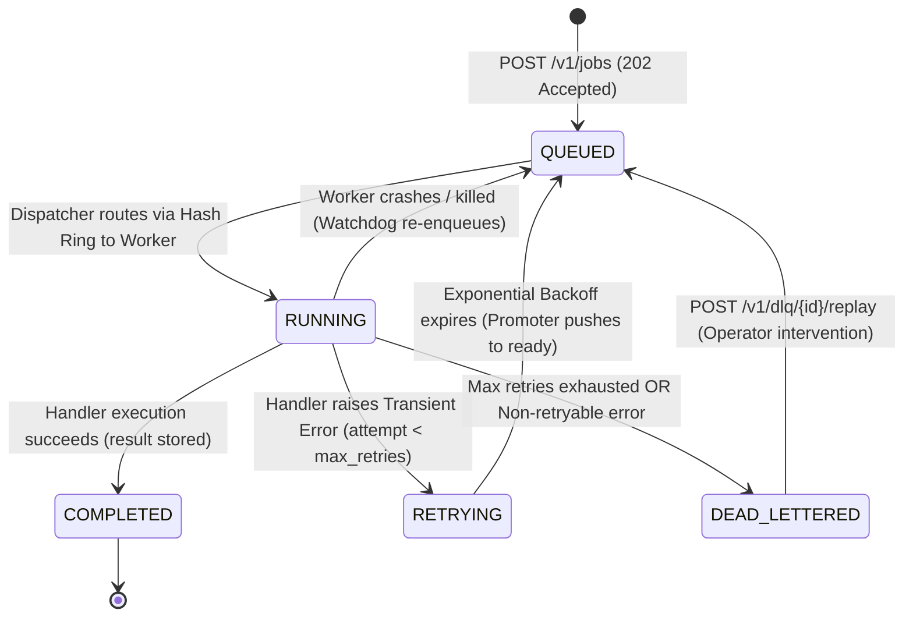
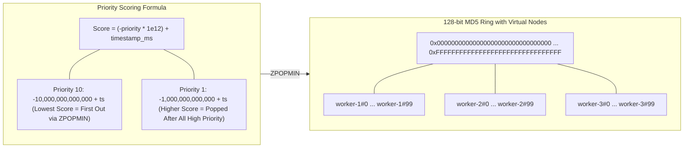

# System Architecture & Component Blueprint

This document details the architectural blueprints for the **High-Concurrency Distributed Task Queue & Rate-Limited API Gateway**, illustrating data flows, scheduling mechanics, worker failover, and persistence layers.

---

## 1. End-to-End System Architecture

```mermaid
flowchart TD
    subgraph Clients["External Clients & Consumers"]
        C1["HTTP Client (X-API-Key: client-A)"]
        C2["HTTP Client (X-API-Key: client-B)"]
        WB["wrk / Locust Benchmark Runners"]
    end

    subgraph Gateway["API Gateway Layer (FastAPI / Uvicorn)"]
        GW["FastAPI Router (/v1/jobs, /health, /metrics, /v1/dlq)"]
        RL["Atomic Token-Bucket Limiter (Lua Script)"]
        VAL["Pydantic v2 Payload Validator (Max 64 KB)"]
        IDEM["Idempotency Filter (PostgreSQL Lookup)"]
    end

    subgraph Redis["Redis 7 Core Datastore"]
        R_TB[("ratelimit:{client_id}<br/>Tokens & Last Refill")]
        R_READY[("queue:ready (Sorted Set)<br/>Score = -priority * 1e12 + ts")]
        R_DELAY[("queue:delayed (Sorted Set)<br/>Score = next_retry_timestamp")]
        R_DLQ[("queue:dlq (List)<br/>Dead Letter Queue FIFO")]
        R_ACTIVE[("workers:active (Hash)<br/>worker_id -> host:port")]
        R_HB[("worker:heartbeat:{id}<br/>String (TTL 10s)")]
        R_INFLIGHT[("worker:inflight:{id}<br/>Set (job_id_str)")]
    end

    subgraph Dispatcher["Consistent-Hash Dispatcher Layer"]
        DISP["Dispatcher Core Engine"]
        RING["Consistent Hash Ring (MD5, 100 vnodes)"]
        WATCH["Heartbeat Watchdog (2s Interval)"]
        PROMO["Retry Promoter Loop (1s Interval)"]
        CONN_POOL["gRPC Channel Pool (Multiplexed)"]
    end

    subgraph Workers["Stateless gRPC Worker Pool (Scalable N)"]
        W1["Worker Container 1<br/>(gRPC Port 50051)"]
        W2["Worker Container 2<br/>(gRPC Port 50051)"]
        W3["Worker Container 3<br/>(gRPC Port 50051)"]
        
        subgraph WorkerInternal["Worker Internal Architecture"]
            SEM["Bounded Concurrency (asyncio.Semaphore)"]
            HB_EMIT["Heartbeat Emitter (Interval 3s)"]
            HANDLERS["Pluggable Handlers<br/>(sleep, cpu_hash, webhook, fail_sim)"]
        end
    end

    subgraph Postgres["PostgreSQL 16 Relational Store"]
        PG_JOBS[("jobs table<br/>UUID, idempotency_key, status,<br/>priority, payload, attempt, worker")]
        PG_ATTEMPTS[("job_attempts table<br/>attempt_id, job_id, worker_id,<br/>started_at, finished_at, error")]
    end

    %% Client to Gateway
    C1 -->|"POST /v1/jobs"| GW
    C2 -->|"GET /v1/jobs/{id}"| GW
    WB -->|"High-Concurrency wrk"| GW

    %% Gateway Operations
    GW -->|"1. Rate Limit Check"| RL
    RL <-->|"EVALSHA token_bucket.lua"| R_TB
    GW -->|"2. Schema Validation"| VAL
    GW -->|"3. Idempotency Check & Insert"| PG_JOBS
    GW -->|"4. Atomic Ready Push"| R_READY

    %% Dispatcher Operations
    R_ACTIVE -->|"Discover Nodes"| DISP
    DISP -->|"Build Ring"| RING
    DISP -->|"ZPOPMIN (Priority FIFO)"| R_READY
    DISP -->|"Hash(job_id) -> Node"| RING
    DISP -->|"Invoke ExecuteTask"| CONN_POOL
    CONN_POOL -->|"HTTP/2 gRPC"| W1
    CONN_POOL -->|"HTTP/2 gRPC"| W2
    CONN_POOL -->|"HTTP/2 gRPC"| W3

    %% Retry & Watchdog
    PROMO -->|"ZRANGEBYSCORE <= now"| R_DELAY
    PROMO -->|"ZADD due jobs"| R_READY
    WATCH -->|"Check worker:heartbeat:*"| R_HB
    WATCH -->|"Evict dead node"| RING
    WATCH -->|"Re-enqueue stranded jobs"| R_READY
    WATCH <-->|"Read & Delete"| R_INFLIGHT

    %% Worker Execution
    W1 -.-> WorkerInternal
    W2 -.-> WorkerInternal
    W3 -.-> WorkerInternal
    HB_EMIT -->|"SETEX TTL 10s"| R_HB
    HB_EMIT -->|"HSET workers:active"| R_ACTIVE
    SEM -->|"SADD job_id"| R_INFLIGHT
    HANDLERS -->|"Update Status & Record Attempt"| PG_JOBS
    HANDLERS -->|"Insert Attempt Row"| PG_ATTEMPTS
    HANDLERS -->|"On Transient Error: ZADD"| R_DELAY
    HANDLERS -->|"On Exhausted Retries: LPUSH"| R_DLQ
```



---

## 2. Job State Lifecycle & Transitions



---

## 3. High-Availability Worker Failover Sequence

```mermaid
sequenceDiagram
    autonumber
    actor Client
    participant Gateway as API Gateway
    participant Redis as Redis Keyspace
    participant Dispatcher as Dispatcher & Watchdog
    participant Worker1 as Worker Container 1
    participant Worker2 as Worker Container 2 (Surviving)
    participant DB as PostgreSQL

    Client->>Gateway: POST /v1/jobs (priority: 10, sleep 8s)
    Gateway->>DB: INSERT INTO jobs (status: QUEUED)
    Gateway->>Redis: ZADD queue:ready (score: -1e13 + ts)
    Gateway-->>Client: 202 Accepted (job_id: uuid-123)

    Dispatcher->>Redis: ZPOPMIN queue:ready
    Redis-->>Dispatcher: Return uuid-123
    Dispatcher->>Dispatcher: Hash(uuid-123) -> Worker 1
    Dispatcher->>Worker1: gRPC ExecuteTask(uuid-123)
    Worker1->>Redis: SADD worker:inflight:worker-1 (uuid-123)
    Worker1->>DB: UPDATE jobs SET status='RUNNING', assigned_worker='worker-1'
    Worker1->>DB: INSERT INTO job_attempts (status='STARTED')

    Note over Worker1: Worker 1 killed by host (docker kill / OOM)
    Note over Worker1: Heartbeats cease; container terminates

    loop Every 2 Seconds
        Dispatcher->>Redis: Scan worker:heartbeat:* keys
    end
    Note over Dispatcher: TTL expires on worker:heartbeat:worker-1
    Dispatcher->>Dispatcher: Evict worker-1 from Hash Ring
    Dispatcher->>Redis: HDEL workers:active worker-1
    Dispatcher->>Redis: SMEMBERS worker:inflight:worker-1
    Redis-->>Dispatcher: [uuid-123]
    Dispatcher->>Redis: ZADD queue:ready (uuid-123)
    Dispatcher->>Redis: DEL worker:inflight:worker-1
    Dispatcher->>DB: UPDATE jobs SET status='QUEUED' WHERE id=uuid-123

    Dispatcher->>Redis: ZPOPMIN queue:ready
    Redis-->>Dispatcher: uuid-123
    Dispatcher->>Dispatcher: Hash(uuid-123) -> Worker 2 (surviving)
    Dispatcher->>Worker2: gRPC ExecuteTask(uuid-123)
    Worker2->>DB: UPDATE jobs SET status='RUNNING', assigned_worker='worker-2'
    Worker2->>DB: INSERT INTO job_attempts (status='STARTED', attempt=2)
    Worker2->>Worker2: Execute handler (sleep completes)
    Worker2->>DB: UPDATE jobs SET status='COMPLETED'
    Worker2->>DB: UPDATE job_attempts SET status='COMPLETED'
    Worker2->>Redis: SREM worker:inflight:worker-2 (uuid-123)

    Client->>Gateway: GET /v1/jobs/uuid-123
    Gateway->>DB: SELECT * FROM jobs WHERE id=uuid-123
    DB-->>Gateway: status='COMPLETED', result={...}
    Gateway-->>Client: 200 OK (status: COMPLETED)
```

---

## 4. Priority Ingestion & Consistent Hashing Topology


