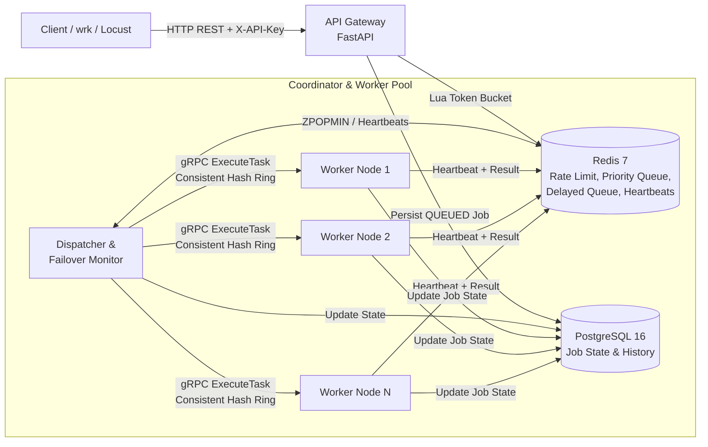
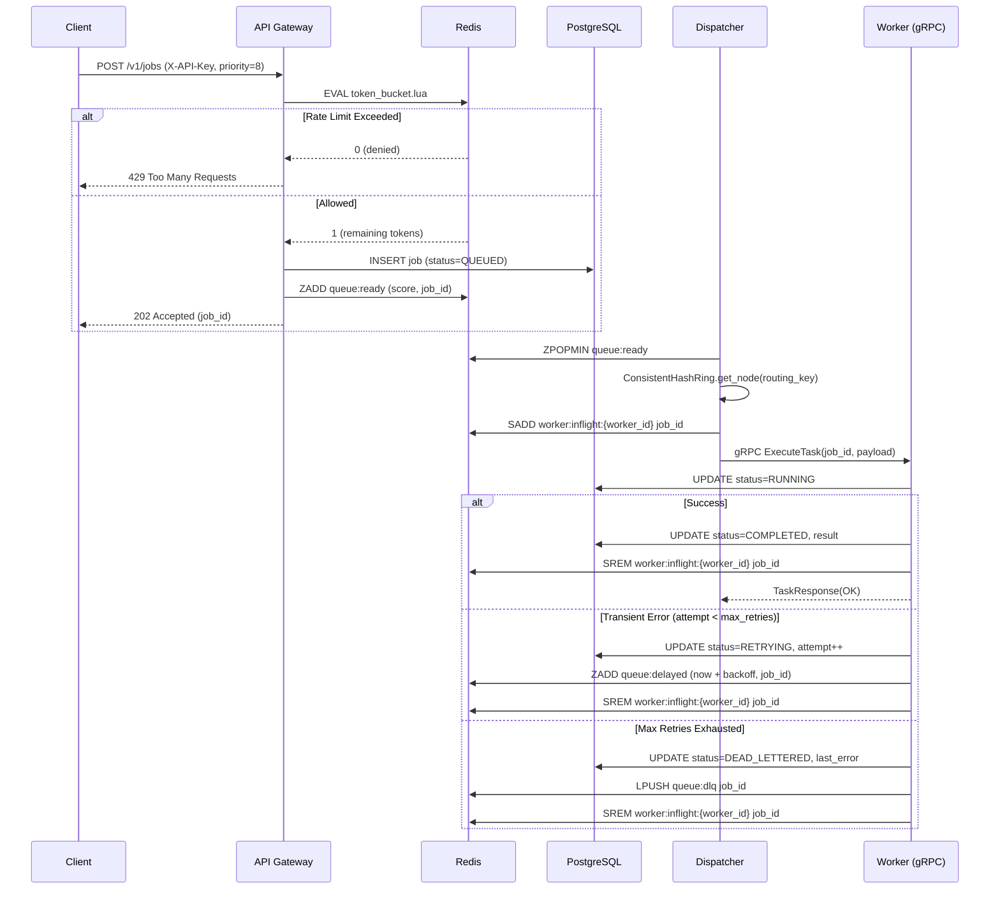

# System Architecture

## 1. High-Level Architecture Diagram

---

## 2. Core Components

### 2.1 API Gateway (`services/gateway`)
* Exposes REST endpoints (`/v1/jobs`, `/v1/dlq`, `/health`, `/metrics`).
* Middleware executes the **Redis Lua Token-Bucket** check before hitting route handlers.
* Validates payloads, enforces idempotency via PostgreSQL, inserts `QUEUED` jobs, and pushes job IDs to Redis `queue:ready`.

### 2.2 Dispatcher & Failover Monitor (`services/dispatcher`)
* Runs three lightweight async background loops:
  1. **Delayed-to-Ready Promoter:** Moves due jobs from `queue:delayed` (`ZSET`) to `queue:ready` (`ZSET`).
  2. **Consistent-Hash Dispatcher:** Pops highest-priority jobs from `queue:ready`, selects a healthy worker from the **Consistent Hash Ring**, records the job in `worker:inflight:{worker_id}`, and dispatches via gRPC.
  3. **Heartbeat Watchdog:** Scans registered workers every `2s`. If `worker:heartbeat:{worker_id}` has expired, removes the worker from the ring and re-enqueues all jobs in `worker:inflight:{worker_id}`.

### 2.3 Stateless Worker Pool (`services/worker`)
* Exposes a gRPC server (`WorkerService.ExecuteTask`, `WorkerService.HealthCheck`).
* Registers itself in Redis (`workers:active`) on startup and refreshes `worker:heartbeat:{worker_id}` every `3s` (TTL `10s`).
* Executes pluggable task handlers (`sleep`, `cpu_hash`, `webhook`, `fail_sim`) using a bounded concurrency semaphore (`WORKER_MAX_CONCURRENCY`).
* Updates PostgreSQL job status and clears `worker:inflight:{worker_id}` upon completion or failure.

---

## 3. Job Lifecycle & Failover Sequence

---

## 4. Security & Error-Handling Architecture
* **Input Validation:** Strict Pydantic v2 schemas; max payload size capped at `64 KB` to prevent memory exhaustion.
* **Rate-Limit Isolation:** Per-API-Key buckets prevent a single noisy client from starving other tenants.
* **Timeouts:** Every gRPC call carries an explicit deadline (`GRPC_TASK_TIMEOUT_SEC`); PostgreSQL and Redis pools enforce connection timeouts.
* **Graceful Shutdown:** Workers handle `SIGTERM` by stopping new gRPC accepts, finishing in-flight tasks up to a grace period, and deregistering cleanly.