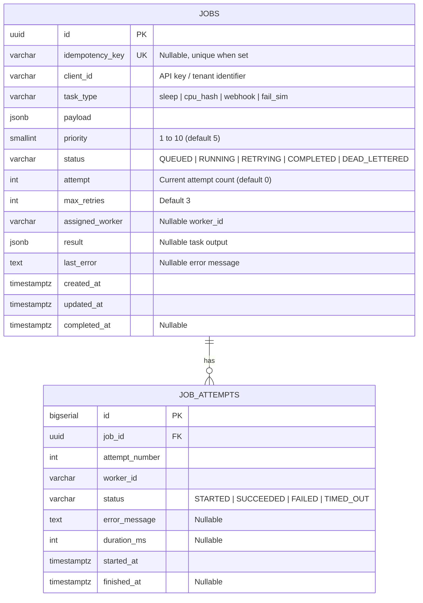

# Database Schema & Redis Keyspace Design

## 1. PostgreSQL Entity-Relationship Diagram



---

## 2. PostgreSQL DDL & Indexes

```sql
CREATE TABLE jobs (
    id UUID PRIMARY KEY,
    idempotency_key VARCHAR(128) UNIQUE,
    client_id VARCHAR(64) NOT NULL,
    task_type VARCHAR(64) NOT NULL,
    payload JSONB NOT NULL DEFAULT '{}'::jsonb,
    priority SMALLINT NOT NULL DEFAULT 5 CHECK (priority BETWEEN 1 AND 10),
    status VARCHAR(20) NOT NULL DEFAULT 'QUEUED',
    attempt INT NOT NULL DEFAULT 0,
    max_retries INT NOT NULL DEFAULT 3,
    assigned_worker VARCHAR(64),
    result JSONB,
    last_error TEXT,
    created_at TIMESTAMPTZ NOT NULL DEFAULT NOW(),
    updated_at TIMESTAMPTZ NOT NULL DEFAULT NOW(),
    completed_at TIMESTAMPTZ
);

CREATE INDEX idx_jobs_status_created ON jobs (status, created_at DESC);
CREATE INDEX idx_jobs_client_id ON jobs (client_id);
CREATE INDEX idx_jobs_dlq ON jobs (created_at DESC) WHERE status = 'DEAD_LETTERED';

CREATE TABLE job_attempts (
    id BIGSERIAL PRIMARY KEY,
    job_id UUID NOT NULL REFERENCES jobs(id) ON DELETE CASCADE,
    attempt_number INT NOT NULL,
    worker_id VARCHAR(64) NOT NULL,
    status VARCHAR(20) NOT NULL,
    error_message TEXT,
    duration_ms INT,
    started_at TIMESTAMPTZ NOT NULL DEFAULT NOW(),
    finished_at TIMESTAMPTZ
);

CREATE INDEX idx_job_attempts_job_id ON job_attempts (job_id);
```

---

## 3. Redis Keyspace Design

| Key Pattern | Redis Type | TTL | Purpose |
| :--- | :--- | :--- | :--- |
| `ratelimit:{client_id}` | `HASH` (`tokens`, `last_refill`) | `3600s` | Token-bucket state accessed atomically via Lua script. |
| `queue:ready` | `ZSET` | None | Priority queue. Score = `(-priority * 1e12) + epoch_ms`. Member = `job_id`. |
| `queue:delayed` | `ZSET` | None | Retry queue. Score = `next_retry_epoch_ms`. Member = `job_id`. |
| `queue:dlq` | `LIST` | None | Dead-lettered `job_id`s for fast inspection/replay. |
| `workers:active` | `HASH` | None | Maps `worker_id` -> `host:port` gRPC address. |
| `worker:heartbeat:{worker_id}` | `STRING` | `10s` | Refreshed every `3s` by worker; expiry triggers failover. |
| `worker:inflight:{worker_id}` | `SET` | None | Set of `job_id`s currently executing on `worker_id`. |